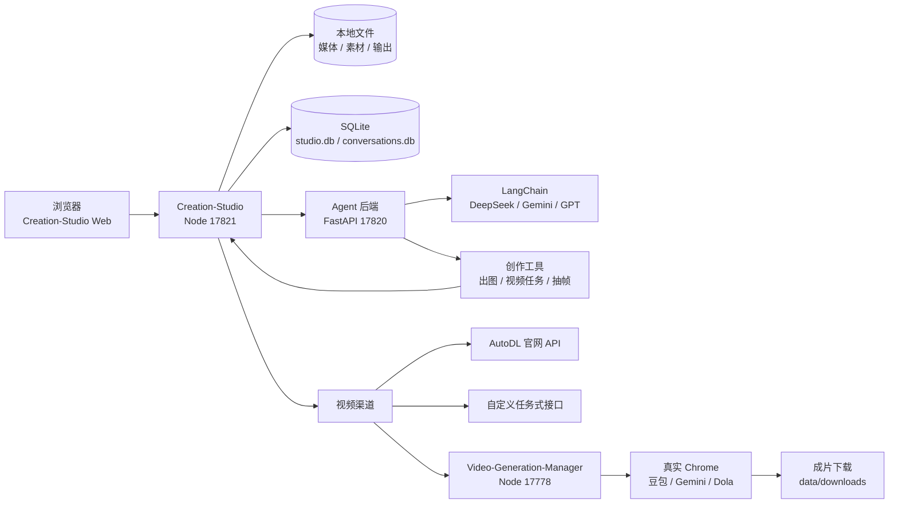

# CREATION-PIPELINE

> 本地 AI 创作流水线：从小说、剧本、分镜、提示词，到图像与视频生成，一条链路跑完。


这是一个**完全跑在本机**的 AI 创作工作台。没有云端账号体系，没有多租户，也没有必须依赖的 SaaS；模型 Key、参考图、成片、任务记录、Chrome 登录状态都留在本地目录里。

仓库包含两个可以独立运行、也可以串起来用的项目：

| 项目 | 作用 | 默认端口 |
| --- | --- | --- |
| [Creation-Studio](./Creation-Studio/README.md) | 创作台：视频 / 图像 / 智能体创作链路、素材库、媒体库、剪映导出 | `17821` |
| [Video-Generation-Manager](./Video-Generation-Manager/README.md) | 视频任务管理器：豆包 / Gemini / Dola 账号、浏览器调度、下载与插件回传 | `17778` |
| Creation-Studio 智能体后端 | FastAPI + LangChain 的创作智能体，供创作台 `/api/agent/*` 透传 | `17820` |

---

## 目录

- [它能做什么](#它能做什么)
- [整体架构](#整体架构)
- [快速开始](#快速开始)
- [目录结构](#目录结构)
- [技术栈](#技术栈)
- [数据与安全](#数据与安全)
- [测试](#测试)
- [当前状态与边界](#当前状态与边界)
- [文档](#文档)

---

## 它能做什么

### 1. 创作链路：小说 → 剧本 → 分镜 → 提示词 → 视频

创作台的智能体不是通用聊天助手，身份固定为 **AI 视频创作专家**。它按一条链路工作：

```text
小说创作 → 小说转剧本 → 剧本转分镜 → 分镜转视频提示词 → 提示词生成视频
```

- 前四步在对话里完成，每一步的产出都可以点「下一步」继续，附带上一步的交付文件。
- 最后一步「送到创作台」把提示词写进视频创作台，用官网 API、自定义渠道或本机管理器出片。
- 阶段规则放在 `agent_backend/app/creation_guidance.py`，也可以用 `agent_backend/data/guidance.json` 覆盖，改提示词不用改代码。
- 技能系统支持自定义：在「插件管理」里新建 `skill`，填写 instructions，下一轮立即生效。

智能体具备真实的创作工具：列出模型、生成图像、提交视频任务、查询进度、等待成片、读视频信息、抽帧检查。不是演示桩。

### 2. 视频创作台

- 9 张参考图 + 3 段音频（内置音色 / 本地音频）
- 六段式提示词骨架，`<Picture N>` / `<Subject N>` / `<Audio N>` 标签插入
- 渠道：官网 API（AutoDL）、自定义任务式接口、本机管理器（豆包 / Gemini）
- 模型切换自动带出画幅与时长；Gemini 固定 10 秒
- 实时校验、字数统计、示例、Skill 优化、复制、清空
- 右侧舞台显示成片、进度和最近任务

### 3. 图像创作台

- 三个页签：图像生成、图像编辑（参考图 + 指令）、图像反推（图 → 英文提示词）
- 多图像渠道：OpenAI Images、Gemini 生图、Chat Completions 生图
- 画布工具：打开 / 粘贴 / 保存、撤销重做、选区 / 裁剪 / 尺寸、缩放 / 适应 / 1:1
- 结果落盘到媒体库，可存素材库，也可以直接当视频参考图
- A/B 对比页：双联、叠加、同步播放、导出并排合成

### 4. 素材、媒体与剪辑

- **素材库**：角色 / 场景 / 道具文件夹、搜索、命名主体、重命名、移动、上传
- **媒体库**：按日期 / job 扫成片和图像，视频用系统默认播放器打开，支持 HTTP Range
- **分集**：项目下建「第 N 集」，把成片拖到分集上归入，只记归属不搬文件
- **导入剪映**：按镜头顺序把一集写成剪映草稿，打开剪映就能接着剪
- **任务日志**：每条任务写 `data/logs/<job>.log`，界面可查看

### 5. 声音

- **音色库**：扫描本地 800+ 克隆参考音色目录，按音色名 / 分组 / 样本台词 / 时长列出，可搜索、试听、选中进音频槽
- **系统音色**：Windows SAPI 离线合成 WAV，填台词、选发音人、调语速
- 音频槽里的音色会被提示词中的 `<Audio N>` 引用

### 6. 视频任务管理器

Video-Generation-Manager 负责「账号 → 浏览器 → 提示词 / 参考图 → 视频 → 下载 → 插件回传」：

- 豆包、Gemini、Dola 多平台账号，独立 Chrome 配置目录
- 两套调度：网页版（Playwright 驱动 `doubao.com`）和客户端版（接管官方豆包桌面客户端）
- 任务表格、筛选、明细、配额、下载记录
- 豆包无水印原片解析（fallback_api）、MP4 头与 FFprobe 校验
- Gemini 视频：要求 Google AI Pro / Ultra，必须走代理，固定 10 秒、16:9 / 9:16
- 字字动画薄插件：按宿主 `generate(context)` 契约回传成片
- 七套主题、三种组件风格、三档动态强度、HTTP/HTTPS 代理设置

### 7. 其他

- 本机单账号登录（scrypt 加盐，30 天 HttpOnly cookie）
- 项目 + 风格系统：每个项目绑定一套风格前置提示词
- 白昼动漫壁纸库：静态图片 / 动态壁纸 / 我的收藏，支持 GIF、WebP、视频
- 顶栏服务控制：一键启动 / 停止智能体和管理器
- 创作台状态持久化到 SQLite（`data/studio.db`），刷新不丢

---

## 整体架构



关键设计：

- **创作台与智能体分离**：Node 负责页面、文件、任务和渠道；Python 负责对话、规划、工具调用和上下文。两边用内部 token 通信。
- **智能体与视频管理器分离**：智能体只调用创作台的视频接口；创作台再把「本机管理器」渠道转发到 17778。换平台不用改智能体。
- **所有生成都落本地**：参考图、音频、成片、日志、数据库都在 `data/` 下，方便备份和迁移。

---

## 快速开始

### 环境要求

- Windows 10 / 11
- Node.js ≥ 22（本机 25.9 已验证）
- Python 3.11（智能体后端）
- Google Chrome（视频管理器）
- FFprobe（视频校验；本机默认 `D:/notebook/software/ffmpeg/bin/ffprobe.exe`）

### 1. 启动 Creation-Studio

推荐一条命令拉起管理器（可选）→ 智能体 → 创作台：

```bat
cd Creation-Studio
start-all.cmd
```

也可以手动按顺序启动：

```bat
:: 1) 创作台 Web，先启动它会生成内部调用凭据
cd Creation-Studio
node src/server.js

:: 2) 智能体后端
cd agent_backend
.venv\Scripts\python.exe -m uvicorn app.main:app --host 127.0.0.1 --port 17820

:: 3) 视频管理器（可选，需要豆包 / Gemini 出片时）
cd ..\..\Video-Generation-Manager
node src/server.js
```

打开 <http://127.0.0.1:17821>。

首次使用会要求创建本机账号。模型 Key 在 `agent_backend/data/agent_settings.json`，渠道 Key 在创作台「设置 → 渠道管理」。

### 2. 启动视频管理器

```bash
cd Video-Generation-Manager
npm ci
./start.sh
# 或 node src/server.js
```

打开 <http://127.0.0.1:17778>。

需要已安装 Chrome 和 FFprobe。使用 Gemini 时必须在「系统管理 → 代理」填 HTTP 代理（例如 `http://127.0.0.1:7897`），否则会被地区限制。

### 3. 端口

| 服务 | 端口 | 说明 |
| --- | --- | --- |
| Creation-Studio Web | `17821` | 创作台、素材库、媒体库 |
| Agent 后端 | `17820` | FastAPI + LangChain |
| Video-Generation-Manager | `17778` | 豆包 / Gemini 任务管理 |

端口可用环境变量覆盖：`WMD_PORT`、`AGENT_PORT`、`DBM_REBUILD_PORT`。

---

## 目录结构

```text
CREATION-PIPELINE/
├── Creation-Studio/
│   ├── src/                  Node 服务：路由、任务、渠道、媒体、素材
│   ├── web/                  原生 HTML/CSS/JS，无构建步骤
│   ├── agent_backend/        FastAPI + LangChain 智能体
│   ├── plugins/video/        视频插件
│   ├── prompts/              系统提示词与附加规则
│   ├── tests/                node:test + 本地 mock
│   └── data/                 运行数据（gitignored）
├── Video-Generation-Manager/
│   ├── src/                  任务服务、浏览器池、自动化、下载校验
│   ├── src/v2/               客户端版调度
│   ├── src/adapters/         页面识别、无水印解析
│   ├── web/                  新工作台
│   ├── plugin/               字字动画插件
│   └── data/                 账号、任务、下载（gitignored）
├── docs/                     设计与验收文档
└── README.md
```

---

## 技术栈

| 层 | 选型 |
| --- | --- |
| 创作台服务 | Node.js 原生 `http` / `fs`，无 Web 框架 |
| 创作台界面 | 原生 HTML / CSS / JS，无构建步骤 |
| 智能体后端 | Python 3.11 + FastAPI + LangChain |
| 智能体模型 | DeepSeek / Gemini / OpenAI 兼容协议 |
| 视频管理器 | Node.js + Playwright Core + undici |
| 浏览器自动化 | 真实 Chrome，独立配置目录 |
| 数据 | JSON 文件 + SQLite（`studio.db` / `conversations.db`） |
| 媒体校验 | FFprobe + MP4 头解析 |

---

## 数据与安全

运行数据全部在本地，且已被 `.gitignore` 排除：

- `Creation-Studio/data/`：`config.json`（含 Key）、`users.json`、`jobs.json`、`studio.db`、媒体、素材、日志、内部 token
- `Creation-Studio/agent_backend/data/`：`agent_settings.json`（模型 Key）、`conversations.db`、workspace、日志
- `Video-Generation-Manager/data/`：`accounts.json`、`tasks.json`、`connection.json`、Chrome `profiles/`、`downloads/`、代理设置
- `**/evidence/`：验收截图、测试证据

**不要提交或分享这些目录。** 账号 JSON 可能包含 Cookie，`config.json` / `agent_settings.json` 包含 API Key，Chrome profile 包含登录状态。

备份时先正常退出管理器，再复制完整 `data/`。移除账号只移除列表项，Chrome 配置目录会保留，避免误删登录状态。

---

## 测试

### Creation-Studio

```bash
cd Creation-Studio
npm test
```

`node:test` + 本地 mock 服务，覆盖六段提示词解析、批量 JSON、渠道 CRUD、官网 API 全流程、图像生成 / 编辑、音色与音色库、剧本创作台、外接管理器等。浏览器验收：

```bash
npm run test:workbench-browser
npm run test:image-tasks-browser
npm run test:media-browser
npm run test:refs-browser
npm run test:undo-browser
```

智能体后端：

```bash
cd agent_backend
.venv/Scripts/python.exe -m pytest -q
```

### Video-Generation-Manager

```bash
cd Video-Generation-Manager
npm test
npm run test:browser
npm run test:ui
```

`test:ui` 使用临时数据在真实 Chrome 中检查四页导航、任务明细、账号配额、主题与代理保存，截图保存到 `evidence/ui-*.png`。

---

## 当前状态与边界

这是本地开发中的项目，不是可直接对外部署的 SaaS。

**已经跑通**

- 创作链路：小说 → 剧本 → 分镜 → 提示词 → 视频
- 视频 / 图像创作台、素材库、媒体库、分集、剪映草稿导出
- 智能体工具链：出图、提交视频、等待、抽帧、读视频信息
- 豆包网页版与客户端版调度、无水印原片解析、下载校验
- Gemini 真实账号实测：1280×720、10 秒、无水印，提交到下载约 75 秒
- 本机账号、项目与风格、主题与壁纸、服务控制

**已知限制**

- 仅支持 Windows，本地单机运行
- 视频管理器依赖真实 Chrome，账号风控与平台改版风险由使用者承担
- Dola 尚未完成实测；参考上传目前只支持图片
- 图像画布的蒙版绘制未实现；图像编辑是参考图重绘，不是局部回贴
- 云端机器工作流已移除，只保留官网 API / 自定义渠道 / 本机管理器
- 剪映导入前需要先关闭剪映，否则草稿索引会被覆盖
- 插件没有宿主的运行中取消令牌；取消不会撤回已提交到平台的生成

---

## 文档

- [Creation-Studio 详细说明](./Creation-Studio/README.md)
- [智能体后端说明](./Creation-Studio/agent_backend/README.md)
- [Video-Generation-Manager 详细说明](./Video-Generation-Manager/README.md)
- [设计与验收文档](./docs/)

---

## License

本仓库未附带 `LICENSE` 文件。对外复用、分发或商用前，请先确认代码与第三方依赖的授权。
