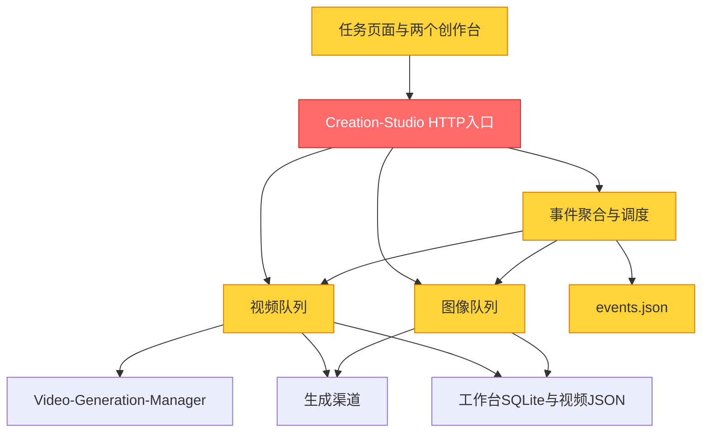

# 任务生命周期闭环：现状评审与实施计划 v2

评审日期：2026-10-25（用户时区）
范围：Creation-Studio 任务页、事件聚合、视频/图像队列、创建接口、运行记录与日志；管理器仅检查接入边界，不执行远端生成。
状态：方案待实施。本次只读取代码、运行隔离诊断和既有测试，新增本文档；不修改业务代码，不启动生成任务。
本计划取代 docs/task-management-plan.md 中与当前目标冲突的设计；旧文档的“P0–P4 已完成”不能视为本闭环已验收。

## 用户约束（已确认）

1. 工作台与任务管理共用创建、校验、参数组合、素材绑定、快照和执行服务。工作台创建单条目事件，批量创建多条目事件；来源只影响默认调度和界面，不另建执行体系。
2. 视频与图像分开管理、调度、监控和查日志，避免大量数据混杂。
3. 页面顶部不展示统计。统计只放在监控区，并随视频/图像筛选变化。
4. 删除页签下重复的标题、介绍段落，例如“视频生成日志／回看每条……”；保留必要字段标签、错误提示和操作反馈。
5. 所有列表每页10条，改为服务端分页；事件条目、执行尝试及日志也分页或增量加载，不能列表分页但接口仍全量返回。
6. 任务流程为创建、校验、入队、调度、执行、监控、结果与日志追溯；批量是稳定提示词下的正常生产方式。

## Module Dependency Graph



图为本次相关服务和内部模块的局部图。管理器/上游未做完整审计；未掌握独立团队归属，不推测团队结构问题。

## 当前结论

**已有执行能力和聚合原型，但尚未形成统一生命周期闭环。** 可复用视频执行器、SQLite图像后台任务、批量JSON解析、媒体生成快照、单项日志、远端查询与部分事件控制。当前主要问题是入口绕过事件、调度能力不对称、状态与记录不统一，以及页面仍以旧模块拼接。

Architecture Audit；局部健康评分45/100（balanced：2项Critical、5项Warning；仅评价本范围，不是全项目评分）。本次不写评审历史配置，保持仅交付计划的范围。

## Findings

### Critical

**F1：创建入口分裂，事件不是执行前必须成立的对象。**

- Symptom：server.js:651 的 /api/batch/add 直接 addJobs，没有创建事件。视频接口 server.js:1129 先入队再 recordJobs；图像 server.js:900 同样事后记录，记录失败被忽略。事件创建接口则调用 createFromJobInputs，走另一条路径。
- Source：Domain-Driven Design — Aggregate Roots；The Mythical Man-Month — Conceptual Integrity。
- Consequence：用户从不同入口提交相同内容，会得到不同的调度、归属和审计结果；执行已经开始时可能根本没有事件记录。批量创建还可能部分落库后失败，无法统一回滚或显示结果。
- Remedy：统一事件创建服务，先持久化事件、条目与派发意图，再由后台派发；旧接口只做兼容转换。工作台和批量入口共享该服务。

**F2：事件列表与既有SSE占用同一路径，实时通道被遮蔽。**

- Symptom：server.js:1164 先处理 GET /api/events 并返回JSON；server.js:1293 才是相同路径的SSE分支。app.js:6563 的 EventSource 仍请求 /api/events。
- Source：Software Engineering at Google — Backward Compatibility；The Pragmatic Programmer — Orthogonality。
- Consequence：在当前代码顺序下，实时订阅得到JSON而不是事件流，原实时任务更新链路失效。事件页8秒轮询不能代替整个应用的实时更新。
- Remedy：列表保留 /api/events；推送迁到 /api/task-events/stream（命名在接口冻结时统一），所有订阅同步迁移；增加Content-Type和断线重连契约测试。

### Warning

**F3：调度字段存在，但缺少真正的事件调度行为。**

- Symptom：events.js:162 保存 order、startAt、retries；tick():304 不消费这些字段。创建REST接口没有把policy/schedule传入createFromJobInputs。实际按事件数组遍历，放行仍靠 jobs.setHeld。
- Source：Domain-Driven Design — Ubiquitous Language；A Philosophy of Software Design — Information Leakage。
- Consequence：不能将“能保存字段”当作定时、优先级或自动重试已经可用；目前没有统一事件排序，也不能保证不同来源的并发公平性。
- Remedy：将调度作为明确服务，落实事件次序、条目次序、到期时间、渠道槽位、暂停后不再派发；对外只暴露已实现能力。

**F4：图像只接入汇总，没有接入事件控制。**

- Symptom：hydrate能读取imageTask，但tick/itemStatusOf/pauseEvent主要查询视频jobMap；retryItem对imageTask没有实际重试分支，retryFailed只操作job。
- Source：The Pragmatic Programmer — Orthogonality；Clean Architecture — Dependency Inversion。
- Consequence：同样的事件操作用于图像可能没有效果；不能承诺视频和图像已经共享任务生命周期。
- Remedy：定义视频/图像执行适配器，统一派发、暂停后续、查询、恢复、重试和日志引用；按能力说明已提交任务能否取消，禁止用本地暂停冒充平台停止。

**F5：统计、跳过和运行状态存在冲突。**

- Symptom：events.js:75 的hydrate未单独累计skipped；done不含failed，却用于页面完成进度。失败停止策略还能给正在运行的条目写skipped覆盖；report又可能直接读取底层job状态绕过事件override。
- Source：Domain-Driven Design — Aggregate Invariants；The Pragmatic Programmer — DRY。
- Consequence：列表、详情、报告可能互相矛盾；全部处理结束仍显示50%；跳过被算成失败，或仍在执行的条目被界面隐藏。
- Remedy：集中定义状态迁移与聚合口径。已处理=成功+失败+取消+跳过；unknown单列，不能自动当作成功或安全可重发。运行中的条目不得被本地skip覆盖。
- 隔离验证：一成功一跳过 → 当前返回failed=1、skipped=0、done=1、partial；一成功一失败 → 已终结但done=1/2。均未调用生成渠道。

**F6：执行尝试未形成事件层的稳定追溯链。**

- Symptom：jobs.js:330重试保留job ID但重置logs、outputs、时间；已有generation_runs会新增部分运行记录，但事件条目只指向job，attempts未维护，事件日志读取的是当前job日志。单条工作台事件反向eventId也没有写回执行记录。
- Source：Domain-Driven Design — Entity Identity；Software Engineering at Google — Code Sustainability。
- Consequence：原失败与新尝试难以从事件完整追溯；事件报告容易只反映最后一次执行，失败归因与复刻记录不完整。
- Remedy：Event → Item → Attempt → Run/RemoteTask/Media稳定关联；追加新尝试，保留旧日志与产物。查询原远端任务与重新提交生成必须分开。

**F7：持久化和分页不适合持续批量生产。**

- Symptom：events.js:34只保存最新200条，没有实现计划中的归档，保存失败被吞；list():144默认仅返回50条且无offset/cursor。图像list():32最多200条并带每条完整日志。现有每页10条为前端切片，不是数据库分页。
- Source：A Philosophy of Software Design — Strategic Programming；Working Effectively with Legacy Code — Seams。
- Consequence：旧事件会从持久化文件消失，活跃事件也未排除；分页无法访问接口已截断的数据；任务多时轮询仍负担很重。
- Remedy：事件、条目、尝试迁入现有SQLite，索引按project/kind/status/createdAt建立；服务端每页10条，列表只返回摘要，日志增量读取；存储失败必须可见且不得开始未持久化的执行。

## 已验证与未验证

- 既有 events.test.js + events-scheduler.test.js：本次17项通过。
- 调度测试使用假的视频jobs执行器，验证部分放行/暂停/取消行为；不覆盖真实HTTP入口、图像事件操作、SSE冲突和完整批量生产。
- 本次仅只读代码审查与无外部副作用的隔离统计验证；没有提交视频或图片生成，没有以绿色单测宣称真实闭环完成。
- events模块直接依赖全局文件与jobs，测试通过require.cache替换依赖；建议调度器注入时钟、仓库与执行适配器。图像模块已有store/channel/generate注入点，可复用。

## 目标页面

```text
任务管理                                      [+ 创建任务]
[视频] [图像]                  固定媒体切换，贯穿下面所有区域

[任务管理] [任务调度] [任务监控] [日志]

对应的工具栏与列表／监控内容
分页：每页10条；事件详情、条目、尝试与日志按需读取
```

- 使用两层导航，但不是把现有五个tab简单改名。媒体切换后保留各自筛选与页码，任何区域都明确当前媒体类型。
- 任务管理：事件列表、创建、草稿编辑、校验、复制为新任务、结果入口；默认按最近创建排序。单条/批量仅是创建方式，不单独占导航。
- 创建任务：单条表单或批量JSON → 素材映射 → 条目预览 → 校验 → 保存草稿/加入队列；用户显式入队前不提交上游。
- 任务调度：事件顺序、条目顺序、立即/指定时间、并发、失败策略、暂停后续/恢复、取消未提交条目；与任务管理是同一批事件的另一种视图。
- 任务监控：当前运行、队列、需要处理的异常；统计只在这里。显示真实阶段、处理进度、成功率、耗时与错误归因；无真实百分比时显示阶段，不编造ETA/成本。
- 日志：按事件/条目/尝试、渠道、错误筛选；视频和图像分别查询。列表摘要不传整份提示词和日志，详情再加载。
- 事件详情采用侧面板或独立详情视图，含条目、素材、快照、执行尝试、结果与日志；不通过嵌套多个弹窗追踪任务。
- 删除顶部统计卡片、CREATION WORKSPACE装饰文案、重复h2与介绍段落。必要提示只在创建字段、错误与空状态中出现。

## 统一数据与执行边界

### 数据关系

Event（一批次）→ Item（一次提示词/素材组合）→ Attempt（一次执行尝试）→ 执行器run、远端任务、日志及媒体。

- Event：projectId、kind(image/video)、source、title、版本、调度配置、状态、时间。首版一个事件一种媒体类型，跨媒体依赖编排另期处理。
- Item：稳定itemId、shotKey、次序、用户提示词、前置词、最终提示词、素材引用/顺序/角色、参数、channelId/model、不可变提交快照版本。
- Attempt：attemptId、itemId、序号、requestId、mode(new/resume)、远端ID、状态、时间、错误分类、runId；不保存明文密钥。
- 草稿可编辑；入队生成固定版本。执行中修改草稿必须另存新版本，不悄悄影响已提交条目。
- 素材需稳定assetId、内容指纹与文件定位；提交前检查可读性与@绑定顺序，不只保存可能失效的临时路径。
- 沿用现有generation_runs、media_records、generation_logs，不另建第二套媒体库；补event/item/attempt外键或关联表。

### 执行契约

- prepare/validate：共享生成参数组合，用户提示词、前置词、布局、参考图绑定与工作台一致，避免重复拼接。
- commit：幂等键+输入哈希；SQLite事务写事件、条目、快照、派发意图（outbox），成功后才允许后台派发。
- dispatch：由一个生命周期服务授权派发，视频与图像适配器执行；渠道/账号槽位仍由现有底层执行器维护，避免两套独立放行规则。
- 工作台默认为立即入队，1个条目；批量默认为草稿校验后入队，N个条目。已有重复次数需在预览中明确展开结果与计数。
- 已提交但结果未知先对账/继续查询；未经确认不能作为安全自动重试。已知提交前失败可按受限策略重试；记录每次尝试。
- 重启恢复待派发条目；已提交项进入待确认，保留远端ID和原输出。不能把重启统一标成业务失败，也不能全部重发。

### 建议接口

- POST /api/task-events/validate；POST /api/task-events（保存草稿/创建单条或批量，必须幂等）。
- POST /api/task-events/:id/queue（固定版本、确认入队）。
- GET /api/task-events?projectId=&kind=&status=&page=&pageSize=10 → items/total/page/pageSize。
- GET /api/task-events/:id/items?page=&pageSize=10；GET /api/task-items/:id/attempts。
- POST /api/task-events/:id/pause|resume|cancel-pending|retry-failed；PUT /api/task-events/:id/schedule。
- GET /api/task-events/stream：版本化状态增量、心跳、断线后快照补偿；列表与流的URL不可冲突。
- GET /api/task-attempts/:id/logs?after=&limit=；GET /api/task-monitor?projectId=&kind=。
- 具体命名实施前冻结；旧/jobs、/images/generate、/batch/add、/events接口保留兼容适配，全部转入同一服务，不能继续形成旁路。

## 实施顺序与验收门槛

| 阶段 | 交付范围 | 必须通过的验收 |
|---|---|---|
| P0 基线与契约 | 固定JSON、状态口径、单条/批量同构、接口、失败与取消能力；记录旧数据样本 | 工作台与批量相同输入得到相同最终提示词、素材次序与参数；旧数据备份可恢复 |
| P1 修复已确认断点 | SSE路径、状态聚合、skip、图像操作真实性、持久化失败显式报错 | SSE返回text/event-stream；成功/失败/取消/跳过/未知统计逐项一致；运行项不被skip掩盖 |
| P2 统一创建与存储 | SQLite事件/条目/尝试与outbox、快照、幂等；工作台及批量共用服务 | 单条=1事件1条目，批量=1事件N条目；重复点击不重复创建；故障注入不出现无归属执行 |
| P3 调度可控 | 图像/视频适配器、事件/条目排序、指定时间、并发、暂停后续、失败策略、重启对账 | 用可控时钟和假执行器验证次序/到期；真实底层队列不超渠道限制；刷新/离开页面不影响执行 |
| P4 页面重构 | 两种媒体切换+管理/调度/监控/日志四区；统一创建预览；删顶部统计和冗余描述；服务端10条分页 | 两个媒体状态隔离；创建入口一致；大数据只加载当前页；可直接追踪条目与尝试，不用来回找旧tab |
| P5 端到端闭环验收 | 报告、媒体追溯、迁移、兼容入口、真实渠道小样本 | 全流程创建→执行→结果→提示词/素材→日志闭环；明确区分模拟验证与真实渠道验证 |

每阶段独立提交、可回滚；优先完成P1–P3关键路径后接P4，不先做一个没有实际调度能力的漂亮界面。

## 验收场景

1. 视频工作台、图像工作台各生成1个条目的事件；任务页分别正确归属，所有参数/素材和结果可追溯。
2. 同样的条目从批量JSON与工作台创建，finalPrompt及引用次序一致，source之外无隐式行为差异。
3. 20条视频/20条图像使用假执行器验证完整批次、并发、部分失败、暂停/恢复、取消未派发、只重试失败项；不为验收默认消耗40次上游额度。
4. 用可控失败验证每次Attempt独立留档；继续查询不提交新生成，重试生成新requestId且保留原失败。
5. 201个事件、超过1000个条目，重启后可检索全部；活跃事件不得被截断。列表接口最多10条摘要，无全量日志。
6. 中断于持久化后/提交前/提交成功回执前/下载中，分别验证恢复与待确认，不重复计费。
7. SSE断开、回连或不可用时恢复一致快照，轮询作为降级；统计和详情不能永久停在旧状态。
8. UI覆盖视频/图像、四区域、空/加载/错误/分页、键盘与小窗口；列表信息不被壁纸覆盖，无多余标题说明。
9. 真实渠道验收采用少量明确的样本，记录正式执行器终态；测试通过不自动视为远端取消能力已经成立。

## 迁移与回滚

- SQLite增量迁移先备份、带schema版本和迁移记录；events.json完整导入，原文件保留只读备份。
- 关联历史job/imageTask/run，缺失关联明确标记“历史记录”，不得猜测分镜归属或静默丢弃。
- 迁移过程不自动派发历史任务。调度器统一所有权，不能新旧调度器同时放行同一条目。
- 分离“暂停新派发”和“继续收集已提交结果”，回滚时停止新派发，保留尝试/远端ID；不得通过恢复旧状态触发重发。
- 旧接口兼容仅一个调用入口；以服务层开关切换，避免长期双写JSON与SQLite造成冲突。

## 下一步范围

实施从P0/P1开始，首批先交付统一JSON/状态契约和已确认断点修复，再进入统一创建与SQLite迁移。本次没有修改此前尚未提交的前端展示改动，也没有提交Git或重启服务。


## 首版实施更新

已按本计划落地核心闭环和页面重构，详细实现、测试及尚未验证的边界见 [实施记录](task-lifecycle-implementation.md)。87项回归通过；真实生成平台验收未执行，不能将首版实施等同于所有P5远端验收完成。
